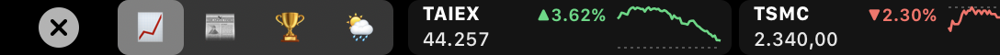
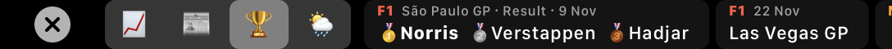
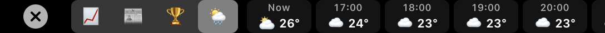
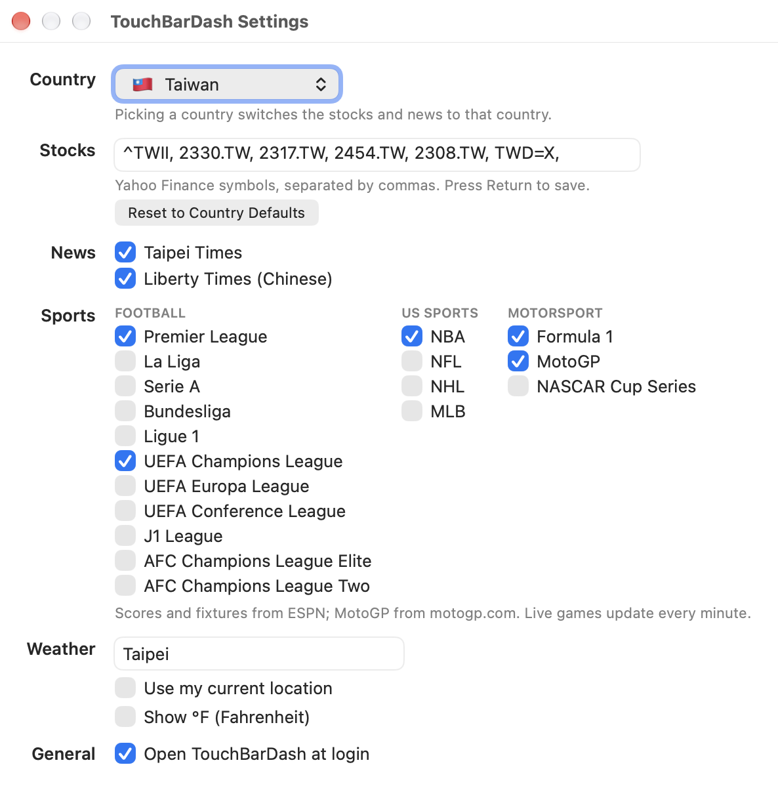

# TouchBarDash ⛅️📈📰🏆

Weather, stocks, news and sports scores on your MacBook Pro's Touch Bar, for whichever country you choose.

Made by **[@lemonspitz](https://github.com/lemonspitz)** · version 1.1

## Screenshots

**📈 Stocks:** price, today's change and a sparkline for each stock (Taiwan shown)



**📰 News:** the latest headlines from the country's news sites (Indonesia: Kompas and Tempo shown)


**🏆 Sports:** the latest scores and fixtures for the competitions you follow; the winner is in bold, live games have a green dot


Races show the last podium and when the next race starts



**🌦️ Weather:** the next 24 hours, hour by hour



**Settings:** pick a country, then fine-tune the stocks, news sources, sports and weather



## Install

**Requirements:** an Apple Silicon Mac with a Touch Bar (13-inch MacBook Pro M1 2020 or M2 2022), macOS 13 or later.

**One-line install (easiest):** paste this into Terminal and press Return:

```bash
curl -fsSL https://raw.githubusercontent.com/lemonspitz/TouchBarDash/main/install.sh | bash
```

It downloads the latest release into Applications and opens it. Look for ⛅️ in the menu bar and in the Touch Bar's Control Strip.

**Or download the DMG:** get [TouchBarDash.dmg](https://github.com/lemonspitz/TouchBarDash/releases/latest/download/TouchBarDash.dmg),
open it, and drag **TouchBarDash** onto **Applications**. The app isn't notarized by Apple, so the first time you open it macOS
will say it can't verify it. Go to **System Settings → Privacy & Security**, scroll down, and click **Open Anyway**.
You only need to do this once.

The first time it runs, macOS asks whether TouchBarDash may use your location. Allow it to get local weather,
or type a city in Settings instead.

## Features

- **Touch Bar:** a ⛅️ button with the current temperature sits in the Control Strip; tap it to show the dashboard over any app.
  The 📈 📰 🏆 🌦️ switch on the left picks what fills the rest of the bar (swipe to scroll):
  - 📈 **Stocks:** price, today's change (▲ green / ▼ red) and a sparkline of today's prices against yesterday's close.
    Tap one to open it on Yahoo Finance.
  - 📰 **News:** the latest headlines from the country's news sites, newest first, each labelled with its source and age.
    Tap one to open the article.
  - 🏆 **Sports:** scores and fixtures for the competitions you pick: results, live games (updated every minute)
    and upcoming kick-offs in your own time zone. Races show the last podium (🥇🥈🥉) and the next race.
    Tap one to open the match or race page.
  - 🌦️ **Weather:** the next 24 hours, hour by hour.
- **Menu bar ⛅️:** current weather (feels-like, high/low, humidity, wind), every stock, and News and 🏆 Sports submenus.
- **Settings** (⛅️ → Settings…, or open the app again from Applications):
  - **Country:** switches the stocks and news to that country.
  - **Stocks:** any [Yahoo Finance](https://finance.yahoo.com) symbols, e.g. `AAPL`, `BBCA.JK`, `^N225`, `BTC-USD`, `GC=F` (gold), `TWDIDR=X`.
  - **News:** choose which of the country's sources to show.
  - **Sports:** tick the competitions to follow (see below).
  - **Weather:** your current location or any city; °C or °F.
  - **Open at login**.

Weather refreshes every 10 minutes, stocks every minute, news every 10 minutes, and sports every 10 minutes (every minute while a game is live). No accounts or API keys needed.

### Countries

| Country | Stocks | News |
|---|---|---|
| 🇮🇩 Indonesia | IHSG, BBCA, BBRI, BMRI, TLKM, ASII, USD/IDR | Kompas, Tempo, CNBC Indonesia, Antara |
| 🇺🇸 United States | S&P 500, NASDAQ, DOW, AAPL, NVDA, MSFT, TSLA, BTC | NPR, The New York Times, CNBC |
| 🇬🇧 United Kingdom | FTSE 100, Shell, AstraZeneca, HSBC, Unilever, GBP/USD | BBC News, The Guardian |
| 🇯🇵 Japan | Nikkei, Toyota, Sony, SoftBank, MUFG, USD/JPY | NHK (Japanese), The Japan Times |
| 🇸🇬 Singapore | STI, DBS, OCBC, UOB, Singtel, USD/SGD | CNA, The Straits Times |
| 🇲🇾 Malaysia | KLCI, Maybank, Public Bank, Tenaga, USD/MYR | Malay Mail, Free Malaysia Today |
| 🇦🇺 Australia | ASX 200, BHP, CBA, CSL, AUD/USD | ABC News, The Sydney Morning Herald |
| 🇮🇳 India | NIFTY 50, SENSEX, Reliance, TCS, HDFC Bank, USD/INR | The Times of India, The Hindu |
| 🇩🇪 Germany | DAX, SAP, Siemens, Allianz, EUR/USD | Tagesschau, Spiegel |
| 🇫🇷 France | CAC 40, LVMH, L'Oréal, TotalEnergies, Airbus, EUR/USD | Le Monde, France 24 |
| 🇹🇼 Taiwan | TAIEX, TSMC, Foxconn, MediaTek, Delta, USD/TWD, TWD/IDR | Taipei Times, Liberty Times (Chinese) |
| 🇰🇷 South Korea | KOSPI, Samsung, SK Hynix, Naver, USD/KRW | Yonhap, The Korea Herald |
| 🇨🇦 Canada | TSX, RBC, Shopify, TD, USD/CAD | CBC News, Global News |

### Sports

| | Competitions |
|---|---|
| ⚽ Football | Premier League, La Liga, Serie A, Bundesliga, Ligue 1, UEFA Champions League, UEFA Europa League, UEFA Conference League, J1 League, AFC Champions League Elite, AFC Champions League Two |
| 🏀 US sports | NBA, NFL, NHL, MLB |
| 🏁 Motorsport | Formula 1, MotoGP, NASCAR Cup Series |

## Data sources

- Weather and city search: [Open-Meteo](https://open-meteo.com)
- Stocks and currencies: Yahoo Finance (prices may be delayed)
- Sports: ESPN's public scoreboards; MotoGP from motogp.com's results service
- News: each publisher's public RSS feed. Kompas has no public feed, so its headlines come from its latest-news page.

Headlines link to the publishers' own sites; all articles belong to their publishers.

## Build from source

Needs the Xcode Command Line Tools (`xcode-select --install`).

```bash
./build.sh      # → build/TouchBarDash.app
./release.sh    # → build/release/TouchBarDash.dmg + .zip
```

The Touch Bar's Control Strip button and system-wide bar use private macOS APIs (DFRFoundation), the same way other
Touch Bar utilities do, so the app can't be sold on the Mac App Store.
